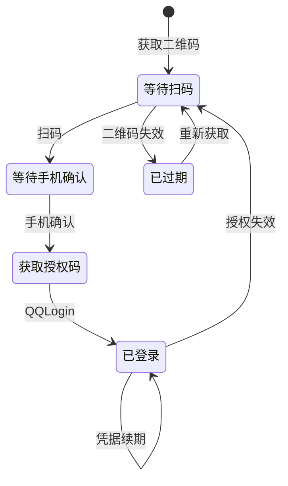

# QQ 音乐接口规范

本文定义 Lyren 的 QQ 音乐适配层使用的 HTTP 请求、资源模型、认证流程与响应约定。

接口名称、字段名及大小写均以服务请求为准。示例中的账号、凭据与资源地址使用占位值；曲目和歌单 ID 用于说明请求结构。

## 目录

1. [通用约定](#1-通用约定)
2. [账号认证与会话](#2-账号认证与会话)
3. [资源标识与数据模型](#3-资源标识与数据模型)
4. [搜索与歌曲资料](#4-搜索与歌曲资料)
5. [歌词](#5-歌词)
6. [音频地址与音质](#6-音频地址与音质)
7. [歌单与收藏](#7-歌单与收藏)
8. [歌手与专辑](#8-歌手与专辑)
9. [榜单推荐与电台](#9-榜单推荐与电台)
10. [评论](#10-评论)
11. [账号数据同步](#11-账号数据同步)
12. [关注与偏好](#12-关注与偏好)
13. [响应与错误处理](#13-响应与错误处理)
14. [签名与内容编码](#14-签名与内容编码)

## 1. 通用约定

### 1.1 服务入口

| 用途 | 方法 | URL |
| --- | --- | --- |
| JSON RPC | POST | `https://u.y.qq.com/cgi-bin/musicu.fcg` |
| 签名 JSON RPC | POST | `https://u.y.qq.com/cgi-bin/musics.fcg?sign=<sign>` |

正文使用 UTF-8 JSON。RPC 的 `module` 和 `method` 标识业务接口，顶层请求键用于关联响应。

```http
POST /cgi-bin/musicu.fcg HTTP/1.1
Host: u.y.qq.com
Content-Type: application/json
Referer: https://y.qq.com/electron_music.html
Origin: https://y.qq.com
```

需要登录态的业务请求附带第 2 节定义的 Cookie。不得把登录凭据放进日志或示例资源链接。

业务读取使用 `musics.fcg` 与常规客户端配置；授权码兑换与会话续期使用 `musicu.fcg`。附带会话的请求同时使用当前账号对应的 Cookie 和业务账号字段。

### 1.2 请求结构

```json
{
  "req_0": {
    "module": "music.pf_song_detail_svr",
    "method": "get_song_detail",
    "param": {"song_id": 4835784}
  },
  "comm": {
    "ct": 20,
    "cv": 1770,
    "tmeAppID": "qqmusic"
  }
}
```

| 字段 | 类型 | 说明 |
| --- | --- | --- |
| `req_0` | object | 请求关联键，可使用 `song`、`search` 等其他名称 |
| `module` | string | 服务模块，区分大小写 |
| `method` | string | 服务方法，区分大小写 |
| `param` | object | 业务参数 |
| `comm` | object | 客户端与会话公共参数 |

一次请求可以携带多个关联键。批量请求中的每个子响应独立判断成功与失败。

### 1.3 客户端参数配置

| 场景 | `comm` 配置 |
| --- | --- |
| 常规资料接口、歌词及普通取流 | `ct:20, cv:1770, tmeAppID:"qqmusic"` |
| Linux 授权码兑换与凭据续期 | `ct:19, cv:1, tmeAppID:"qqmusic"` |

`ct`、`cv` 是请求协议的客户端配置，不等同于软件安装包版本。各接口示例明确指定对应配置。

常规登录请求在 `comm` 中附带数字音乐账号 `uin` 和 `g_tk:hash33(musickey,5381)`，HTTP Cookie 同时保留当前音乐会话。匿名请求省略这两个认证字段。

### 1.4 响应结构

```json
{
  "code": 0,
  "ts": 1790000000000,
  "traceid": "<trace-id>",
  "req_0": {
    "code": 0,
    "data": {}
  }
}
```

成功条件为：HTTP 请求成功、顶层 `code=0`、对应子请求 `code=0`。部分业务数据内还有 `retcode`、`retCode`、`result` 或逐条结果，需要继续处理。

### 1.5 类型与分页

- 数字 ID 使用 64 位整数或无损十进制字符串；公开歌单 ID 可超过 32 位范围。
- `MID`、`media_mid`、`openid`、加密 UIN、评论游标按字符串保存。
- `begin`／`offset` 通常从 0 开始；搜索 `page_num` 从 1 开始。
- 翻页结束依据该接口的 `hasmore`、`HasMore`、`bFinish`、总数或实际返回条数，不混用不同接口的游标。
- 写接口超时后先读取目标状态，再决定是否重发创建、添加或删除请求。

## 2. 账号认证与会话

### 2.1 认证流程

QQ 登录包含以下状态转换：



扫码、状态轮询、授权码兑换和续期均可通过 HTTP 完成。应用自行显示二维码，不要求嵌入 WebView。

### 2.2 QQ 授权配置

| 参数 | 值 |
| --- | --- |
| QQ 音乐 OAuth `client_id` | `100497308` |
| QQ 登录页 `appid`／轮询 `aid` | `716027609` |
| `daid` | `383` |
| `pt_3rd_aid` | `100497308` |
| OAuth scope | `get_user_info` |
| OAuth 回调 | `https://y.qq.com/wk_v17/common_login.html?type=QQ` |
| 登录中转地址 | `https://graph.qq.com/oauth2.0/login_jump` |

OAuth 应用 ID 与 QQ 登录服务的应用 ID 属于不同字段，不可互换。

授权使用 `wk_v17/common_login.html` 回调、`get_user_info` scope，并以 `ct:19, cv:1` 兑换授权码。

### 2.3 获取 QQ 登录二维码

```http
GET https://ssl.ptlogin2.qq.com/ptqrshow
Referer: https://xui.ptlogin2.qq.com/
```

| 参数 | 类型 | 必填 | 值／说明 |
| --- | --- | --- | --- |
| `appid` | string | 是 | `716027609` |
| `e` | integer | 是 | `2` |
| `l` | string | 是 | `M` |
| `s` | integer | 是 | `3` |
| `d` | integer | 是 | `72` |
| `v` | integer | 是 | `4` |
| `t` | string | 是 | 随机值或当前时间 |
| `daid` | string | 是 | `383` |
| `pt_3rd_aid` | string | 是 | `100497308` |
| `u1` | string | 否 | 登录中转地址 |

响应正文为 PNG。每次扫码登录使用独立的 Cookie jar，保留 Cookie 的 Domain、Path、有效期和 HttpOnly 属性；从中读取 `qrsig` 供轮询使用，不将 Cookie 按名称压平成跨域共享的字典。

### 2.4 轮询二维码状态

```http
GET https://ssl.ptlogin2.qq.com/ptqrlogin
Referer: https://xui.ptlogin2.qq.com/
Cookie: qrsig=<qrsig>
```

| 参数 | 值／说明 |
| --- | --- |
| `u1` | 登录中转地址 |
| `ptqrtoken` | `hash33(qrsig, 0)` |
| `ptredirect` | `0` |
| `h`, `t`, `g`, `from_ui` | 均为 `1` |
| `ptlang` | `2052` |
| `action` | `0-0-<当前毫秒时间>` |
| `js_ver` | 登录页 `ptui_version`；可从 `xui.ptlogin2.qq.com/cgi-bin/xlogin` 页面取得 |
| `js_type` | `1` |
| `pt_uistyle` | `40` |
| `aid` | `716027609` |
| `daid` | `383` |
| `pt_3rd_aid` | `100497308` |
| `login_sig` | 登录页提供的 `pt_login_sig`，如存在则传入 |

响应使用 `ptuiCB(...)` 包装。按字符串参数解析，不执行返回的 JavaScript。

| 首个参数 | 状态 |
| --- | --- |
| `66` | 等待扫码 |
| `67` | 已扫码，等待手机确认 |
| `65` | 二维码过期，需要重新获取 |
| `0` | 手机确认成功，第 3 个参数为登录确认 URL |

建议每 2 秒轮询一次；成功、过期或取消后结束该二维码的轮询。
每次轮询响应的 Cookie 更新都应保留，包括尚未确认登录时的响应。

`hash33` 的定义为：

```text
h = initial
for each UTF-16 code unit c:
    h = (h * 33 + c) mod 2^32
return h & 0x7fffffff
```

### 2.5 获取 OAuth 授权码

访问轮询成功返回的完整登录确认 URL，仅接受 `https://ssl.ptlogin2.graph.qq.com/check_sig?` 开头的地址，保留服务端提供的查询参数。携带 `Referer: https://xui.ptlogin2.qq.com/`，沿用本次登录的 Cookie jar 并跟随重定向，由 HTTP 客户端按域名和路径筛选 Cookie，不手工拼接跨域的 `Cookie` 请求头。

从 Cookie jar 中读取对 `https://graph.qq.com/oauth2.0/authorize` 有效的 `p_skey`。同名、不同域或路径的 Cookie 相互独立；清理 `.qq.com` 上的旧值不能覆盖 `.graph.qq.com` 上的新凭据。

随后提交：

```http
POST https://graph.qq.com/oauth2.0/authorize
Content-Type: application/x-www-form-urlencoded
Referer: https://graph.qq.com/
Cookie: <登录确认步骤设置的 Cookie>
```

| 表单字段 | 值／说明 |
| --- | --- |
| `response_type` | `code` |
| `client_id` | `100497308` |
| `redirect_uri` | QQ 音乐 OAuth 回调 |
| `scope` | `get_user_info` |
| `state` | 当前授权会话生成的随机值 |
| `switch` | 空字符串 |
| `from_ptlogin` | `1` |
| `src` | `1` |
| `update_auth` | `1` |
| `openapi` | `1010` |
| `g_tk` | `hash33(p_skey, 5381)` |
| `auth_time` | 当前毫秒时间 |
| `ui` | 当前授权请求的随机标识 |

从重定向 `Location` 的查询参数读取 `code`，并校验 `state`。授权码用于下一步兑换，不作为长期登录凭据保存。

### 2.6 QQ 授权码兑换

**RPC：** `QQConnectLogin.LoginServer / QQLogin`

**入口：** `musicu.fcg`

```json
{
  "login": {
    "module": "QQConnectLogin.LoginServer",
    "method": "QQLogin",
    "param": {
      "onlyNeedAccessToken": 0,
      "forceRefreshToken": 0,
      "appid": 100497308,
      "code": "<authorization-code>"
    }
  },
  "comm": {"ct": 19, "cv": 1, "tmeAppID": "qqmusic"}
}
```

成功响应的 `login.data` 包含以下凭据：

| 字段 | 类型 | 说明 |
| --- | --- | --- |
| `musicid` | integer | 音乐账号 ID |
| `musickey` | string | 音乐服务会话凭据 |
| `openid` | string | QQ 开放平台账号标识 |
| `access_token` | string | 开放平台访问凭据 |
| `refresh_token` | string | 续期凭据 |
| `unionid` | string | 开放平台关联标识 |
| `expired_at` | integer | 服务端过期信息，原样保存 |
| `encryptUin` | string | 加密账号标识，歌单收藏读取和写入使用；凭据续期时一并更新 |

### 2.7 QQ 凭据续期

继续调用 `QQConnectLogin.LoginServer / QQLogin`，使用当前会话与以下参数：

```json
{
  "openid": "<openid>",
  "access_token": "<access-token>",
  "refresh_token": "<refresh-token>",
  "musicid": 123456789,
  "musickey": "<music-key>",
  "onlyNeedAccessToken": 0,
  "forceRefreshToken": 0
}
```

`comm` 与授权码兑换相同。成功后整体替换返回的凭据集合，并更新 HTTP 会话。续期失败且服务要求重新授权时，重新开始扫码流程。

### 2.8 HTTP 会话

| Cookie | 值 |
| --- | --- |
| `uin` | 音乐账号 ID |
| `qqmusic_uin` | 音乐账号 ID |
| `qqmusic_key` | `musickey` |
| `qqmusic_version` | `17` |
| `qqmusic_miniversion` | `70` |
| `psrf_qqopenid` | QQ 账号的 `openid` |
| `psrf_qqaccess_token` | QQ 账号的 `access_token` |

应用使用授权返回的凭据创建 QQ 音乐会话。

凭据通过 systemd 用户凭据接口加密后持久化。配置、日志和普通缓存文件不保存明文凭据。退出账号时清除对应的本地凭据与 HTTP 会话。

## 3. 资源标识与数据模型

### 3.1 标识类型

| 标识 | 示例 | 用途 |
| --- | --- | --- |
| 数字歌曲 ID | `4835784` | 歌曲详情、歌词、评论、歌单写入 |
| 歌曲 MID | `001yS0N33yPm1B` | 搜索、取流、喜欢状态查询 |
| 媒体 MID | `track.file.media_mid` | 构造音频文件名 |
| 专辑 MID | `002qcJuX3lO3EZ` | 专辑详情、曲目、封面 |
| 歌手 MID | `002pUZT93gF4Cu` | 歌手资料、歌曲、专辑、关注 |
| 公开歌单 ID | `7256912512` | `disstid`／`tid`／`v_playlistId` |
| 账号内歌单目录 ID | `dirId`／`dirid` | 自建歌单和“我喜欢”读写 |
| 音乐账号 ID | `musicid`／`str_musicid` | 当前会话的音乐账号 |
| 开放平台标识 | `openid`／`unionid` | 登录与续期 |

公开歌单 ID 与账号目录 ID 分别保存。不同接口的 `uin` 也可能表示音乐 ID、主页标识或加密标识，应使用该接口要求的账号字段。

### 3.2 歌曲对象

| 字段 | 类型 | 说明 |
| --- | --- | --- |
| `id` | integer | 数字歌曲 ID |
| `mid` | string | 歌曲 MID |
| `type` | integer | 歌曲类型，写回歌单时保留 |
| `title`, `name`, `subtitle` | string | 标题、名称、副标题 |
| `singer` | array | 歌手列表，含 `id, mid, name` |
| `album` | object | 专辑，含 `id, mid, title/name` |
| `interval` | integer | 时长，秒 |
| `file` | object | 媒体 MID、各音质文件尺寸等 |
| `pay` | object | 付费相关标记 |
| `action` | object | 当前资源的操作与提示信息 |

歌曲列表有时直接返回歌曲对象，有时包装在 `songInfo` 或 `track` 中；按对应接口的响应路径读取。

## 4. 搜索与歌曲资料

### 4.1 桌面搜索

**RPC：** `music.search.SearchCgiService / DoSearchForQQMusicDesktop`

**入口：** `musicu.fcg`

| 参数 | 类型 | 必填 | 说明 |
| --- | --- | --- | --- |
| `query` | string | 是 | 搜索词 |
| `search_type` | integer | 是 | 歌曲 `0`，歌手 `1`，专辑 `2`，歌单 `3` |
| `page_num` | integer | 是 | 页码，从 1 开始 |
| `num_per_page` | integer | 是 | 每页数量 |
| `searchid` | string | 是 | 搜索会话标识 |

```json
{
  "search": {
    "module": "music.search.SearchCgiService",
    "method": "DoSearchForQQMusicDesktop",
    "param": {
      "query": "海阔天空",
      "search_type": 0,
      "page_num": 1,
      "num_per_page": 15,
      "searchid": "87654321098765"
    }
  },
  "comm": {"ct": 20, "cv": 1770, "tmeAppID": "qqmusic"}
}
```

| 类型 | 结果路径 |
| --- | --- |
| 歌曲 | `search.data.body.song.list` |
| 歌手 | `search.data.body.singer.list` |
| 专辑 | `search.data.body.album.list` |
| 歌单 | `search.data.body.songlist.list` |

分页使用 `data.meta.nextpage`，正数为下一页页码，`-1` 表示结束。共享搜索接口的下一页偏移为 `(nextpage - 1) * num_per_page`；实际返回条数可以小于请求容量。`meta.sum` 表示服务端估计总数。

服务端可要求登录。子请求返回 `2001` 时，读取 `feedbackURL` 并进入认证流程；不将该响应当作搜索成功后的空列表。

### 4.2 歌曲详情

**RPC：** `music.pf_song_detail_svr / get_song_detail`

| 参数 | 类型 | 说明 |
| --- | --- | --- |
| `song_id` | integer | 数字歌曲 ID；可按数字 ID 查询 |
| `song_mid` | string | 歌曲 MID；可按 MID 查询 |
| `song_type` | integer | 业务需要时传歌曲类型 |

响应：

| 路径 | 内容 |
| --- | --- |
| `data.track_info` | 歌曲对象 |
| `data.info` | 歌词、作词、作曲、编曲、制作等资料条目 |
| `data.extras` | 扩展资料 |

普通歌词可从 `data.info` 中 `type="lyric"` 条目的 `content[0].value` 读取。

`track_info.file` 描述各音质资源：`media_mid` 用于构造文件名（见 6.3），`size_try` 为试听文件大小。`try_begin`、`try_end`、`b_30s` 和 `e_30s` 描述客户端高潮窗口，单位为毫秒。RS02 试听资源从歌曲时间轴 0 开始，歌词同步不使用高潮窗口作为起点。

## 5. 歌词

### 5.1 统一歌词接口

**RPC：** `music.musichallSong.PlayLyricInfo / GetPlayLyricInfo`

**入口：** `musicu.fcg`

支持普通 LRC、逐字时间轴、翻译和音译。内容是否存在取决于具体歌曲，空的伴随歌词字段表示该内容没有返回。

| 参数 | 类型 | 必填 | 说明 |
| --- | --- | --- | --- |
| `songId` | integer | 二选一 | 数字歌曲 ID |
| `songMid` | string | 二选一 | 歌曲 MID |
| `type` | integer | 是 | 歌曲类型，普通歌曲使用 `0` |
| `crypt` | integer | 是 | 内容编码选择；普通 LRC 可用 `0`，编码内容使用 `1` |
| `qrc` | integer | 是 | `1` 请求逐字歌词，`0` 请求普通歌词 |
| `trans` | integer | 是 | `1` 请求翻译 |
| `roma` | integer | 是 | `1` 请求音译／罗马音 |
| `lrc_t` | integer | 是 | LRC 版本时间戳，首次传 `0` |
| `qrc_t` | integer | 是 | QRC 版本时间戳，首次传 `0` |
| `trans_t` | integer | 是 | 翻译版本时间戳，首次传 `0` |
| `roma_t` | integer | 是 | 音译版本时间戳，首次传 `0` |
| `needSingingAnnotations` | boolean | 否 | 请求助唱标注，受对应服务权限控制 |

```json
{
  "lyric": {
    "module": "music.musichallSong.PlayLyricInfo",
    "method": "GetPlayLyricInfo",
    "param": {
      "songId": 4835784,
      "type": 0,
      "crypt": 1,
      "qrc": 1,
      "trans": 1,
      "roma": 1,
      "lrc_t": 0,
      "qrc_t": 0,
      "trans_t": 0,
      "roma_t": 0
    }
  },
  "comm": {"ct": 20, "cv": 1770, "tmeAppID": "qqmusic"}
}
```

### 5.2 歌词响应

| 字段 | 类型 | 说明 |
| --- | --- | --- |
| `songID` | integer | 歌曲 ID；注意响应字段的大写 `ID` |
| `songName`, `singerName` | string | 歌曲与歌手名称 |
| `songType` | integer | 歌曲类型 |
| `qrc` | integer | 返回内容的逐字模式标记 |
| `crypt` | integer | 编码模式 |
| `lyric` | string | 原文歌词载荷 |
| `trans` | string | 翻译载荷，可为空 |
| `roma` | string | 音译／罗马音载荷，可为空 |
| `lrc_t`, `qrc_t`, `trans_t`, `roma_t` | integer | 对应内容版本时间戳 |
| `hasContributor`, `hasTransContributor` | boolean | 贡献者信息标志 |
| `hasMultiTrans` | boolean | 多风格翻译标志 |
| `singingAnnotationsLyric` | string | 助唱标注内容，可为空 |

不同字段可使用不同编码。`crypt=0, qrc=0` 的 `lyric` 可为 Base64 LRC，而同一响应的 `roma` 仍可能使用 QRC 编码。逐字歌词及编码选择详见第 14 节。

子请求 `code:24001` 表示没有可用歌词，客户端将其作为正常的空歌词结果，不记录警告。

### 5.3 LRC 与 QRC 格式

LRC 时间标签为 `[mm:ss.fraction]`。小数位数为 1、2、3 时，分别按 100、10、1 毫秒换算。元数据标签包括 `ti`、`ar`、`al`、`by` 和 `offset`。

QRC 内容包含行起点、行时长以及词起点、词时长，单位均为毫秒：

```text
[1000,1200]你(1000,500)好(1500,700)
```

示例表示行区间 `[1000,2200)`；两个词的区间分别为 `[1000,1500)` 和 `[1500,2200)`。词时间为歌曲时间轴上的绝对值，不在行起点上重复相加。

翻译与原文不保证逐行数量相同。使用时间标签对齐；保留各自的时间轴和缺失行。音译也可能具有独立的逐字时间轴。

## 6. 音频地址与音质

### 6.1 获取播放地址

**RPC：** `music.vkey.GetVkey / UrlGetVkey`

**入口：** `musicu.fcg`

| 参数 | 类型 | 说明 |
| --- | --- | --- |
| `uin` | string | 当前音乐账号 ID，匿名为 `"0"` |
| `guid` | string | 客户端资源请求标识 |
| `songmid` | string[] | 歌曲 MID 数组 |
| `songtype` | integer[] | 与歌曲数组对应的歌曲类型 |
| `filename` | string[] | 与歌曲数组对应的目标文件名 |
| `ctx` | integer | 常规请求使用 `0` |

数组的顺序一一对应。对同一歌曲请求多个音质时，可以重复歌曲 MID，并分别设置文件名。

```json
{
  "playback": {
    "module": "music.vkey.GetVkey",
    "method": "UrlGetVkey",
    "param": {
      "uin": "0",
      "guid": "5640789320",
      "songmid": ["003dZWGW0pUQzr", "003dZWGW0pUQzr"],
      "songtype": [0, 0],
      "filename": [
        "M500003dZWGW0pUQzr.mp3",
        "M800003dZWGW0pUQzr.mp3"
      ],
      "ctx": 0
    }
  },
  "comm": {"ct": 20, "cv": 1770, "tmeAppID": "qqmusic"}
}
```

### 6.2 返回字段

| 路径 | 说明 |
| --- | --- |
| `data.sip` | CDN 基址列表 |
| `data.midurlinfo` | 各目标文件的逐条结果 |
| `data.expiration` | 服务返回的有效期信息 |
| `midurlinfo[*].songmid` | 歌曲 MID |
| `midurlinfo[*].filename` | 目标文件名 |
| `midurlinfo[*].result` | 该文件的业务结果 |
| `midurlinfo[*].purl` | 带临时访问参数的相对资源路径 |

使用服务返回的 `sip` 与 `purl` 拼接 URL。子请求成功后仍需检查每个文件的 `result` 和 `purl`。过期后重新取地址，不将签名 URL 当作永久歌曲标识。

### 6.3 常用音质文件名

文件名中的媒体标识优先使用 `track.file.media_mid`。

| 格式 | 前缀 | 扩展名 | 元数据字段 |
| --- | --- | --- | --- |
| AAC | `C400` | `.m4a` | `size_96aac` |
| MP3 128 kbps | `M500` | `.mp3` | `size_128mp3` |
| MP3 320 kbps | `M800` | `.mp3` | `size_320mp3` |
| FLAC | `F000` | `.flac` | `size_flac` |
| APE | `A000` | `.ape` | `size_ape` |
| 试听 MP3 128 kbps（60 s） | `RS02` | `.mp3` | `size_try` |

示例：`M800<media_mid>.mp3`。

文件尺寸表示资源规格信息；可取得的实际音质由文件存在性、账号权益和服务端授权结果共同决定。读取 `pay` 或 `size_flac>0` 不能替代对应音质的取流结果。

加密离线格式、DRM 密钥及付费内容绕过不属于本接口规范。

## 7. 歌单与收藏

### 7.1 公开歌单

**RPC：** `music.srfDissInfo.aiDissInfo / uniform_get_Dissinfo`

```json
{
  "disstid": 7256912512,
  "userinfo": 1,
  "tag": 1
}
```

| 返回字段 | 说明 |
| --- | --- |
| `data.dirinfo` | 名称、简介、封面、创建者、标签、创建与修改时间等 |
| `data.songlist` | 歌曲列表 |
| `data.total_song_num` | 歌曲总数 |
| `data.hasmore` | 是否有更多歌曲 |
| `data.code`, `data.subcode` | 歌单业务结果 |

分页读取使用 `music.srfDissInfo.DissInfo / CgiGetDiss`：

```json
{
  "optype": 0,
  "disstid": 7256912512,
  "onlysonglist": 1,
  "song_begin": 0,
  "song_num": 100
}
```

`song_begin` 为歌曲偏移。公开可见性不授予修改权限；不可见、已删除和受限歌曲按返回状态呈现。

### 7.2 账号歌单与收藏列表

以下读取使用当前登录会话。`uin` 为目标音乐账号 ID；访问范围受该账号的隐私设置和当前会话权限控制。

| module | method | 参数 | 主要返回字段 |
| --- | --- | --- | --- |
| `music.musicasset.PlaylistBaseRead` | `GetPlaylistByUin` | `uin` | `total, v_playlist, v_delTid, bFinish` |
| `music.musicasset.PlaylistFavRead` | `GetPlaylistFavInfo_v2` | `uin, offset, size` | 收藏歌单的分页结果 |
| `music.musicasset.PlaylistDetailRead` | `GetUniformSongDetailInfo` | `uin, dirid, bPaged:true, offset, size` | `list, hasmore, total` |

`GetUniformSongDetailInfo.hasmore` 为 JSON 布尔值（`true`／`false`）。

`GetPlaylistFavInfo_v2` 的 `uin` 使用登录返回的 `encryptUin`。成功响应中的 `v_list:[]` 表示空收藏；`80050` 等业务错误分别处理。条目字段为 `tid, name, songnum, logo`，其中 `songnum` 使用小写。

目录歌曲可能有数字 `id`，但 `mid` 为空、缺失或为 `null`。列表保留这类条目及其顺序，分页偏移按全部条目数计算；播放时对缺少 MID 的单曲提示未提供播放信息，不让单曲影响整个歌单的读取。

分页读取账号内目录示例：

```json
{
  "songs": {
    "module": "music.musicasset.PlaylistDetailRead",
    "method": "GetUniformSongDetailInfo",
    "param": {
      "uin": "<musicid>",
      "dirid": 201,
      "bPaged": true,
      "offset": 0,
      "size": 100
    }
  },
  "comm": {"ct": 20, "cv": 1770, "tmeAppID": "qqmusic"}
}
```

目录 `201` 表示当前账号的“我喜欢”。普通自建歌单使用列表响应给出的目录 ID，不使用公开 `tid` 代替。

### 7.3 创建、编辑与删除歌单

账号写入使用登录会话；业务写请求采用 `musics.fcg` 与第 14 节的签名。写入结果按业务响应和资源读回确认。

**模块：** `music.musicasset.PlaylistBaseWrite`

| 方法 | 参数 | 说明 |
| --- | --- | --- |
| `AddPlaylist` | `dirName, dirShow:1, dirDesc:"", dirPicUrl:"", taglist:""` | 创建歌单，目录 ID 见 `data.result.dirId` |
| `EditPlaylist` | `dirId, mask:15, dirNewName, dirNewDesc, dirNewPicUrl, dirNewtaglist` | 更新名称、简介、封面和标签 |
| `DelPlaylist` | `dirId` | 删除当前账号拥有的歌单 |

创建参数示例：

```json
{
  "dirName": "通勤",
  "dirShow": 1,
  "dirDesc": "",
  "dirPicUrl": "",
  "taglist": ""
}
```

`EditPlaylist` 的 `mask:15` 对应完整字段更新。编辑前先读取现有名称、简介、封面和标签，带上需要保留的字段。`dirNewtaglist` 使用逗号连接标签 ID；不把未编辑字段用空值覆盖。

编辑资料读取仍使用 `uniform_get_Dissinfo`，参数为 `dirid, optype:3, tag:1, userinfo:0, pic_dpi:300`。标签目录使用 `music.musicasset.PlaylistTag / getPlaylistTag`，参数 `{}`，结果见 `data.categories`。

### 7.4 添加、移除与排序歌曲

**模块：** `music.musicasset.PlaylistDetailWrite`

| 方法 | 参数 | 用途 |
| --- | --- | --- |
| `AddSonglist` | `dirId, bFmtUtf8:true, v_songInfo` | 添加歌曲 |
| `DelSonglist` | `dirId, bFmtUtf8:true, v_songInfo` | 移除歌曲 |
| `SeqSonglist` | `dirId, v_songPair` | 提交歌曲顺序 |

增删歌曲需显式传布尔值 `bFmtUtf8:true`，让响应里的中文提示使用 UTF-8；省略时可能返回 GBK，导致 HTTP 200 的响应被 UTF-8 JSON 解析器拒绝。喜欢／取消喜欢使用同一约定。

`v_songInfo` 的元素包含数字歌曲 ID 和歌曲类型：

```json
{
  "dirId": 123,
  "bFmtUtf8": true,
  "v_songInfo": [
    {"songId": 4835784, "songType": 0},
    {"songId": 1032765, "songType": 0}
  ]
}
```

排序时，`v_songPair` 按目标顺序提交完整歌曲列表；元素仍为 `songId, songType`，不是旧位置与新位置组成的数值对：

```json
{
  "dirId": 123,
  "v_songPair": [
    {"songId": 1032765, "songType": 0},
    {"songId": 4835784, "songType": 0}
  ]
}
```

`SeqSonglist` 还需处理 `data.retCode`。完成写入后重新读取目录内容，以服务端返回的歌曲及顺序更新本地状态。

顺序响应要求显式整数 `data.retCode=0`；不将缺省、`retcode` 或创建歌单使用的对象型 `result` 当作成功。客户端提交目录的完整 ID／类型列表并读回核对，写响应因网络问题丢失时也先读取目标状态；确认当前顺序已匹配即可结束，不重发写请求。

### 7.5 “我喜欢”与歌单收藏

喜欢／取消喜欢歌曲分别调用 `AddSonglist`／`DelSonglist`，`dirId` 固定为 `201`。歌曲类型取自歌曲对象。

| 功能 | RPC | 参数 |
| --- | --- | --- |
| 收藏歌单 | `music.musicasset.PlaylistFavWrite / FavPlaylist` | `uin, v_playlistId:[公开歌单ID]` |
| 取消收藏歌单 | `music.musicasset.PlaylistFavWrite / CancelFavPlaylist` | `uin, v_playlistId:[公开歌单ID]` |

收藏和取消收藏的 `uin` 使用登录返回的 `encryptUin`。写响应的 `data.result` 是整数，成功为 `0`；同时检查 `data.v_failedPlaylistId`，顶层成功但目标 ID 在失败列表中仍表示操作失败。这与自建歌单写操作的对象型 `result` 不同。写入成功后用加密标识重新读取收藏列表。

喜欢歌曲、收藏歌单和自建歌单是不同资源。客户端分别刷新对应列表及状态缓存。

## 8. 歌手与专辑

### 8.1 歌手

| module | method | 参数 | 结果 |
| --- | --- | --- | --- |
| `music.musichallSinger.SingerInfoInter` | `GetSingerDetail` | `singer_mids:[mid], pic:1, group_singer:1, wiki_singer:1, ex_singer:1` | `data.singer_list` |
| `music.musichallSong.SongListInter` | `GetSingerSongList` | `singerMid, begin, num, order` | `data.songList[*].songInfo, totalNum` |
| `music.musichallAlbum.AlbumListServer` | `GetAlbumList` | `singerMid, order, begin, num`；可附 `types` | 专辑列表 |

歌手歌曲参数示例：

```json
{
  "singerMid": "002pUZT93gF4Cu",
  "begin": 0,
  "num": 20,
  "order": 1
}
```

不同列表的 `order` 属于各自方法的排序配置，不作为跨接口通用枚举。关注歌手见第 12 节。

### 8.2 专辑

| module | method | 参数 | 结果 |
| --- | --- | --- | --- |
| `music.musichallAlbum.AlbumInfoServer` | `GetAlbumDetail` | `albumMid`；数字 ID 查询使用 `albumID` | `basicInfo, company, singer, extra` |
| `music.musichallAlbum.AlbumSongList` | `GetAlbumSongList` | `albumMid, begin, num, order:2` | `songList[*].songInfo, totalNum` |

专辑曲目参数示例：

```json
{
  "albumMid": "002qcJuX3lO3EZ",
  "begin": 0,
  "num": 20,
  "order": 2
}
```

`basicInfo` 可包含专辑名称、发行时间、语种、流派、简介和颜色。歌曲播放权限仍按单首歌曲的取流结果判断。

### 8.3 专辑收藏

| RPC | 参数 |
| --- | --- |
| `music.musicasset.AlbumFavRead / GetAlbumFavInfo` | `uin` |
| `music.musicasset.AlbumFavWrite / FavAlbum` | `uin, v_albumMid:[mid]` |
| `music.musicasset.AlbumFavWrite / CancelFavAlbum` | `uin, v_albumMid:[mid]` |

专辑收藏读取和写入的 `uin` 使用当前音乐账号 ID 的十进制字符串。收藏写入遵循第 7.3 节的会话和签名约定。

### 8.4 封面资源

优先使用响应中的图片 URL、`pmid` 和动态封面资料。普通专辑封面地址为：

```text
https://y.qq.com/music/photo_new/T002R300x300M000<albumMid>.jpg?max_age=2592000
```

`basicInfo.color` 可用于主题主色；缺少颜色时由客户端根据封面取色。图片资源的缓存与音频临时地址分别管理。

## 9. 榜单推荐与电台

### 9.1 榜单

**模块：** `music.musicToplist.Toplist`

| 方法 | 参数 | 返回 |
| --- | --- | --- |
| `GetAll` | `{}` | `data.group[*].toplist`，含榜单 ID 与期号 |
| `GetDetail` | `topid, num, period` | 当期榜单资料和 `data.songInfoList` 等 |

使用 `GetAll` 返回的榜单 ID 和 `period` 请求详情。日榜、周榜等期号格式不同，不用本地日期生成所有榜单的期号。

### 9.2 推荐、分类与新歌新碟

| module | method | 参数 | 用途 |
| --- | --- | --- | --- |
| `playlist.PlaylistAllCategoriesServer` | `get_all_categories` | `qq:""` | `data.v_group[*].v_item`, 含 `id, name, status, source` |
| `music.playlist.PlaylistSquare` | `GetRecommendFeed` | `From, Size` | `data.List[*].Playlist.basic`, 含 `HasMore, FromLimit` |
| `playlist.HotRecommendServer` | `get_new_hot_recommend` | `cmd:0, page, daily_page, size` | 推荐模块，歌单见 `data.modules[*].grids` |
| `music.recommend.TrackRelationServer` | `GetRadarSong` | `Page:1, ReqType:0, FavSongs:[], EntranceSongs:[]` | 雷达推荐，歌曲见 `data.VecSongs[*].Track` |
| `playlist.PlayListCategoryServer` | `get_category_content` | `caller, category_id, page, use_page:1, size` | 分类歌单 |
| `newsong.NewSongServer` | `get_new_song_info` | `type` | 新歌列表 |
| `newalbum.NewAlbumServer` | `get_new_album_info` | `area, start, num` | 新碟列表 |

`category_id`、`area`、`type` 等业务枚举由各自目录或配置提供。各接口的枚举分别管理。

推荐响应可能包含多个模块；`size` 不表示整份响应的总卡片数。个性化内容需要登录，推荐流不等同于每日推荐、私人电台的完整业务契约。

分类 ID 由目录接口返回。`status:0, source:0` 的分类使用 `get_category_content`。分类页返回 `data.content.total_cnt` 和 `data.content.v_item[*].basic`。歌单资料包括 64 位 `tid`、`title`、`song_cnt`、`creator.nick` 和封面地址。

相似歌曲使用 `music.recommend.TrackRelationServer / GetSimilarSongs`，参数为数字 `songid`；结果见 `data.vecSong[*].track`，使用标准歌曲模型。

新歌目录见 `data.lanlist`，其中 `type` 为请求 ID、`lan` 为显示名：5 最新、1 内地、6 港台、2 欧美、4 韩国、3 日本。新碟地区参数为：1 内地、2 港台、3 欧美、4 韩国、5 日本。两者的地区 ID 独立；新碟结果见 `data.albums` 和 `data.total`，专辑标识使用 `mid`，歌手见 `singers`，发行日期见 `release_time`。

### 9.3 音乐电台

**RPC：** `music.radioProxy.MbTrackRadioSvr / get_radio_track`

```json
{
  "id": 99,
  "num": 5,
  "from": 0,
  "scene": 0,
  "song_ids": []
}
```

`id:99` 为猜你喜欢，歌曲见 `data.tracks`，使用第 3 节的标准歌曲对象。客户端在一批歌曲播放完成前请求下一批，播放地址仍通过第 6 节获取。桌面配置使用登录会话；其他音乐电台的 ID 取对应目录。

跳过当前歌曲是播放队列操作；长期屏蔽偏好通过第 12.2 节单独提交。

## 10. 评论

### 10.1 评论对象

| `BizType` | 对象 |
| --- | --- |
| `1` | 歌曲 |
| `2` | 专辑 |
| `3` | 歌单 |
| `4` | 榜单 |

`BizId` 使用对应评论业务的对象标识。歌曲评论使用数字歌曲 ID，不使用媒体 MID。

### 10.2 热评、最新评论与回复

**模块：** `music.globalComment.CommentReadServer`

| 方法 | 参数 |
| --- | --- |
| `GetHotCommentList` | `BizType, BizId, LastCommentSeqNo, PageSize, PageNum, HotType, WithAirborne` |
| `GetNewCommentList` | `BizType, BizId, LastCommentSeqNo, PageSize, PageNum, FromCommentId, WithHot` |
| `GetReplyCommentList` | `RootCmId, LastCommentSeqNo, PageSize, LastRankScore, RankType, PageNum` |

`PageNum` 从 0 开始。热评常用 `PageSize:25, HotType:1, WithAirborne:0`；最新评论可用 `WithHot:0`；回复列表可用 `PageSize:10`。后续页保留上页评论的序号及相应排序游标。

| 返回字段 | 说明 |
| --- | --- |
| `data.CommentList.Comments` | 评论项 |
| `data.CommentList.HasMore` | 是否有更多评论 |
| `data.CommentList.Total` | 总数信息 |
| `data.CommentList.NextOffset` | 后续读取位置 |
| `CmId` | 评论标识 |
| `SeqNo`, `RankScore` | 序号和排序值 |
| `ReplyCnt`, `SubComments` | 回复数量和附带回复 |

不同方法的游标分别保存。

`CmId` 是包含前缀与编码内容的字符串，原样传递，不从 `SeqNo` 推导评论 ID。`SeqNo` 和 `RankScore` 也按字符串保存；楼中楼请求传回最后一项的两个字段，`PageNum` 从 `0` 递增，排序配置为 `RankType:0`。`IsPraised` 是当前账号的整数点赞标记，`ReplyCnt` 为回复数量。

回复分页使用 `HasMore` 判断是否继续；后续页的 `Total:0` 不覆盖已有总数。评论与回复的 `data.SubCode` 按业务结果检查。

### 10.3 发布、删除与点赞

以下操作需要登录。

| RPC | 参数 | 说明 |
| --- | --- | --- |
| `music.globalComment.CommentWriteServer / AddComment` | `BizType, BizId, Content, RepliedCmId` | 发布或回复评论；回复时指定目标评论 |
| `music.globalComment.CommentWriteServer / DelComment` | `CommentId` | 删除具有操作权限的评论 |
| `GlobalComment.GlobalCommentWriteServer / UpdateHotComment` | `comment_id, type, uin` | `type=3` 点赞，`4` 取消点赞 |

`music.globalComment` 与 `GlobalComment` 的大小写按表中原值使用。发布成功、内容可见、审核状态和点赞结果按相应业务响应分别处理。

`UpdateHotComment.uin` 使用当前音乐账号的字符串 ID，`comment_id` 使用读取结果的 `CmId`。操作结果按对应子请求 `code` 判断，写请求不自动重发。

新评论只传 `BizType`、`BizId`、`Content`，回复再传原样的 `RepliedCmId`；榜单沿用 `BizType:4` 并去掉应用内部的 `top:` 前缀。`Content` 使用 JSON 字符串编码，保留中文、emoji、换行、引号和反斜杠。子请求 `code` 与 `data.SubCode` 均须成功，并检查 `AddedCmId`；`Msg` 用于显示业务拒绝原因，`VerifyUrl` 非空时提示在 QQ 音乐完成验证。写请求单次提交，不因断线自动重发。服务确认接收后刷新列表，不将接收确认解释为所有用户均可见。`IsSelf` 标记自己的评论和回复，删除入口只对这些项显示；确认后调用 `DelComment`，校验子请求 `code` 和 `data.SubCode`，成功后刷新列表和回复数。

## 11. 账号数据同步

### 11.1 云端资料库

本规范的同步范围是当前账号的歌单、喜欢歌曲及各类收藏。读取入口为：

| 资源 | 读取方法 | 写入方法 |
| --- | --- | --- |
| 自建歌单目录 | `GetPlaylistByUin` | `AddPlaylist, EditPlaylist, DelPlaylist` |
| 歌单内容及顺序 | `GetUniformSongDetailInfo` | `AddSonglist, DelSonglist, SeqSonglist` |
| 喜欢歌曲 | `GetUniformSongDetailInfo`，目录 `201` | 目录 `201` 的 `AddSonglist, DelSonglist` |
| 收藏歌单 | `GetPlaylistFavInfo_v2` | `FavPlaylist, CancelFavPlaylist` |
| 收藏专辑 | `GetAlbumFavInfo` | `FavAlbum, CancelFavAlbum` |

方法所属模块及完整参数见第 7、8 节。

### 11.2 客户端同步流程

1. 恢复凭据并续期，建立当前账号的 HTTP 会话。
2. 读取目录、喜欢歌曲和各类收藏，按资源 ID 建立本地缓存。
3. 打开歌单时按目录 ID 分页读取歌曲，保留数字歌曲 ID、类型及顺序。
4. 写入成功后重新读取受影响的资源，并更新本地缓存。
5. 窗口重新激活或用户请求刷新时，重新读取需要更新的资源。

`v_delTid`、`v_delTids`、`v_failTids` 和 `bFinish` 按所属响应处理。它们不构成通用的增量同步协议：本规范没有定义全局同步令牌、服务器推送、冲突版本号或事务提交接口。

每个账号的缓存独立保存。切换账号时切换相应目录、收藏和状态缓存；临时播放 URL 也按会话和有效期处理。

### 11.3 本地播放状态

队列、循环与随机模式、音量、当前进度、歌词偏移和重启恢复由客户端保存。它们可以独立于账号资料库工作；本地恢复不作为跨设备同步的依据。

## 12. 关注与偏好

### 12.1 歌手及用户关注

**歌手模块：** `Concern.ConcernSystemServer`

| 方法 | 参数 | 说明 |
| --- | --- | --- |
| `cgi_concern_user_v2` | `opertype, source:0, userinfo:{usertype:1,userid:<歌手MID>}` | `opertype=0` 关注，`1` 取消 |

歌手关注请求附带 `encrypt_singerid:1`，`userinfo.usertype:1`，`userinfo.userid` 使用歌手 MID。用户关系通过下列列表接口读取。

关系列表模块为 `music.concern.RelationList`：

| 方法 | 参数 |
| --- | --- |
| `GetFollowSingerList` | `From, Size`，按目标主页附带 `HostUin` |
| `GetFollowUserList` | `From, Size`，按目标主页附带 `HostUin` |
| `GetFansList` | `From, Size`，按目标主页附带 `HostUin` |

个人主页的普通 UIN、音乐账号 ID 和加密标识按相应接口分别使用。

### 12.2 屏蔽偏好

**模块：** `music.feedback.FeedbackBlack`

| 方法 | 用途 |
| --- | --- |
| `GetDislikeList` | 读取屏蔽列表 |
| `AddDislike` | 添加屏蔽歌曲、歌手或风格 |
| `CancelDislike` | 取消相应类别的屏蔽 |

读取参数和添加时使用的 ID 类型分别为：

| 内容类别 | `GetDislikeList.Cmd` | 下一页游标字段 | `AddDislike.IdType` |
| --- | --- | --- | --- |
| 歌曲 `Songs` | `3` | `SongLastid` | `1` |
| 歌手 `Singers` | `2` | `SingersLastid` | `2` |
| 风格 `Styles` | `4` | `StyleLastid` | `3` |

`GetDislikeList` 从 `Page:1` 开始；非空页后递增 `Page`，并把该类别最后一项的 `ID` 作为字符串传入对应游标字段。读取到该类别的空列表结束，不根据 `Page` 回显或 `Token` 推导统一分页状态。

响应包含 `data.Retcode`、`Songs`、`Singers`、`Styles`。条目字段为字符串 `ID, Name, Img`、整数 `IdType, Time`；`Img` 可以缺省。按原样保留 `ID` 和 `IdType`，取消时不从显示类别重新猜测 ID 类型。

添加歌曲示例：

```json
{"Songs":[{"ID":"4835784","Name":"晴天","IdType":1}]}
```

`CancelDislike` 使用相同的类别数组，条目 ID、名称及 ID 类型来自已读取的列表。两种写操作均要求子请求成功且 `data.Retcode=0`，字段大小写不可替换为 `retcode`；网络失败不自动重发，成功后重新读取受影响的类别。

屏蔽偏好属于账号设置；临时跳过歌曲仅影响本地播放队列。

### 12.3 账号资料

| RPC | 参数 | 返回 |
| --- | --- | --- |
| `userInfo.BaseUserInfoServer / get_user_baseinfo_v2` | `vec_uin:[音乐账号ID字符串]` | `data.code, data.map_userinfo[uin]`，账号资料含 `headurl, nick` |

会员状态与歌曲播放授权分别判断，资源可用性由取流响应确定。

### 12.4 资源分享

资源可通过 QQ 音乐公开歌曲、专辑、歌手、歌单页面链接分享。客户端当前使用以下公开页面：

| 资源 | 链接 | 标识 |
| --- | --- | --- |
| 歌曲 | `https://i.y.qq.com/v8/playsong.html?songid=<id>` | 数字歌曲 ID，无 MID 歌曲同样可生成链接 |
| 歌单 | `https://y.qq.com/n/ryqq/playlist/<id>` | 公开歌单 ID，自建目录取读取结果的 `tid` |
| 专辑 | `https://y.qq.com/n/ryqq/albumDetail/<mid>` | 专辑 MID，不使用评论线程的数字 ID |
| 歌手 | `https://y.qq.com/n/ryqq/singer/<mid>` | 歌手 MID |
| 榜单 | `https://y.qq.com/n/ryqq/toplist/<id>` | 榜单数字 ID，去掉客户端内部的 `top:` 前缀 |

没有公开歌单 ID 的私有目录不提供分享链接。复制链接使用完整公开页面地址。

## 13. 响应与错误处理

### 13.1 判断顺序

按以下层次处理结果：

1. HTTP 状态、响应正文是否完整以及 JSON是否可解析。
2. RPC 顶层 `code`。
3. 对应关联键下的 `code`。
4. `data` 内的业务码、逐条 `result`、权益提示和必需的资源地址。

歌曲搜索与音频取流分别使用各自的成功条件。空列表、业务失败、没有权限和没有对应音质分别呈现；批量请求可出现部分成功。

### 13.2 返回码上下文

下表按具体请求说明返回码，不定义跨模块通用错误码枚举。

| 场景 | 返回 | 处理 |
| --- | --- | --- |
| 搜索子请求 | `2001`，可附 `feedbackURL` | 按服务提示处理登录／认证，不显示为无匹配结果 |
| 签名入口 | `2000` | 检查签名配置、输入正文和请求入口；保留原始错误上下文 |
| `UrlGetVkey` 的 FLAC 文件条目 | `result:104003` 且 `purl` 为空 | 该请求没有取得该文件；不据此断言所有 FLAC 的统一限制原因 |

### 13.3 重试、凭据与诊断

网络瞬时失败可有限重试，服务限流时按响应要求延迟。认证失败先执行一次会话续期；仍需授权时转入登录流程。取流地址过期时重新获取，不修改临时访问参数。

写请求可能已在服务端生效而客户端未收到响应。重发前读取相应状态；删除、添加、排序和创建不假定具有相同的幂等行为。

诊断记录包含模块、方法、HTTP 状态、业务码和服务端追踪 ID。授权码、Cookie、音乐会话密钥、开放平台凭据及完整签名资源地址不写入日志。

## 14. 签名与内容编码

### 14.1 签名正文

Linux 签名配置使用 `zzc` 前缀。签名对象为包含所有业务子请求和 `comm` 的完整请求正文。

1. 完成请求对象，保留字段插入顺序，不对键排序。
2. 序列化为紧凑 JSON，不添加缩进、额外空格或末尾换行；非 ASCII 字符使用原始 Unicode 字符。
3. 将序列化结果记为 `S`，签名直接使用其 UTF-8 字节。
4. 对 `S` 计算签名，将其放入 `musics.fcg` 的 `sign` 查询参数。
5. 发送同一份 `S` 的 UTF-8 字节作为请求正文。

顶层关联键和字段顺序都是签名输入的一部分。计算签名之后，不再增加 `comm`、修改参数或重新序列化正文。

### 14.2 Linux `zzc` 算法

设 `D=SHA1(UTF8(S))`，为 20 字节摘要；`H` 为 `D` 的大写十六进制字符串，共 40 个字符。以下字符下标均从 0 开始。

```text
head_indices = [23, 14, 6, 36, 16, 7, 19]
tail_indices = [16, 1, 32, 12, 19, 27, 8, 3]

mask = [
    89, 39, 179, 150, 218, 82, 58, 252, 177, 52,
    186, 123, 120, 64, 242, 133, 143, 161, 121, 179
]

head = concatenate(H[i] for i in head_indices)
tail = concatenate(H[i] for i in tail_indices)
mixed[i] = D[i] XOR mask[i], i = 0..19
middle = standard_base64(mixed)
middle = remove all "=", "/", "+" characters from middle
sign = lowercase("zzc" + head + middle + tail)
```

`middle` 使用标准 Base64 后删除指定字符，不使用 Base64URL 的 `-`／`_` 替换规则。整个结果最后转成小写。

签名计算向量：

| 输入字符串 `S` | `sign` |
| --- | --- |
| 空字符串 | `zzcf0e03e5gx4qeiq5cfgdyqwu7sdqfsb5fro3aa45059` |
| `{}` | `zzcf8e26805gyafigxmxjehoe02mvsjjgtwzw6f1a05f1` |
| `{"query":"周杰伦"}` | `zzcd01dd27o7bhc94y5rowjwmo133r17pred2357df9` |

空字符串仅用于算法自检，不是合法的 RPC 正文。

### 14.3 `g_tk` 与二维码令牌

`g_tk` 与 `sign` 是不同字段：

| 用途 | 计算 |
| --- | --- |
| 二维码轮询 `ptqrtoken` | `hash33(qrsig, 0)` |
| QQ OAuth 表单 `g_tk` | `hash33(p_skey, 5381)` |
| 音乐会话 `g_tk` | `hash33(musickey, 5381)` |
| 无音乐会话的网页请求 | `5381` |

`hash33` 见第 2.4 节。不同阶段取各自的会话字段，不把 `qrsig`、`p_skey` 与 `musickey` 互换。

### 14.4 歌词载荷类型

`GetPlayLyricInfo` 的每个内容字段分别解码。请求标记和常见原文载荷的对应关系为：

| 请求配置 | `lyric` 载荷 | 解码后的文本 |
| --- | --- | --- |
| `crypt:0, qrc:0` | Base64 | UTF-8 LRC |
| `crypt:1, qrc:0` | 十六进制 QRC 编码 | UTF-8 LRC |
| `qrc:1` | 十六进制 QRC 编码 | UTF-8 逐字歌词 |

`trans` 和 `roma` 按各自实际载荷处理；特别是 `roma` 可在原文为 Base64 LRC 时仍使用十六进制 QRC 编码。空字段直接表示没有返回该内容。

### 14.5 QRC 编码流程

网络接口的十六进制 QRC 载荷按以下顺序解码：

```text
hex string
  -> hexadecimal bytes
  -> QRC-compatible DES-EDE block decryption
  -> zlib decompression
  -> UTF-8 text
  -> LRC or QRC time-axis parsing
```

固定的 24 字节 ASCII 编码密钥为：

```text
!@#)(*$%123ZXC!@!@#)(NHL
```

按顺序拆分为 8 字节的 `K1, K2, K3`。密文按 8 字节分块，各块独立处理，没有 CBC 链接或 IV；对每一块依次执行 `K3` 解密、`K2` 加密、`K1` 解密。

QRC 使用的 DES 变体包含字节序和密钥扩展差异，不能直接用普通 DES-EDE3-ECB 得到兼容结果。精确定义如下。

### 14.6 QRC DES 变体

以标准 DES 的 IP、FP、PC-1、PC-2、E、S-box、P 和 16 轮 Feistel 结构为基础。表中位序采用标准 DES 的从高位到低位编号。S-box 有两处取值调整：`S2[1][7]=15`、`S4[3][5]=10`，行列下标均从 0 开始。

定义 `W` 为分别反转 8 字节输入的两个 4 字节字：

```text
W([b0,b1,b2,b3,b4,b5,b6,b7])
  = [b3,b2,b1,b0,b7,b6,b5,b4]
```

单 DES 变体采用以下规则：

1. 数据块先执行 `W`，再执行标准 IP；最终执行标准 FP 后再次执行 `W`。
2. 8 字节子密钥先执行 `W`，再执行标准 PC-1，得到 28 位的 `C0, D0`。
3. 每轮按下列轮移位数，对 `C`、`D` 分别做 28 位循环左移，得到 `Ci, Di`。
4. 仅在生成该轮子密钥时使用 `Di_star = (Di << 1) & 0x0fffffff`，再计算 `Ki = PC2(Ci || Di_star)`。下一轮仍从 `Ci, Di` 继续旋转，不从 `Di_star` 继续。
5. 其余 DES 轮函数保持标准定义。加密按第 1 至第 16 轮使用子密钥，解密反序使用同一组子密钥。

```text
round_shifts = [1,1,2,2,2,2,2,2,1,2,2,2,2,2,2,1]
```

这里 `||` 表示拼接两个 28 位值。PC-2 右半部分的取位等价于在标准 0 起算合并位置 `p` 上，用 `D` 的位置 `p-27`，而非标准的 `p-28`；超出 28 位的末端为 0。第 4 步的表达式直接给出了这一兼容行为。

完整 EDE 变体的单块向量，使用第 14.5 节固定密钥：

| 项目 | 十六进制 |
| --- | --- |
| 加密前的 8 字节 | `51514d5553494321` |
| 加密后的 8 字节 | `923dd8137d15fefa` |

加密前文本为 ASCII `QQMUSIC!`。该向量只校验分组变换，不包含 zlib 或歌词格式。

各块解密并拼接后，将结果交给 zlib 读取到压缩流结束。压缩流后可能包含分组填充字节，不预先按 PKCS#7 删除末尾内容。解压及 UTF-8 解码完成后，再按第 5.3 节解释时间轴。

本节仅定义网络歌词字段的内容编码，不定义本地 `.qrc` 文件头、音频加密或离线下载文件格式。
